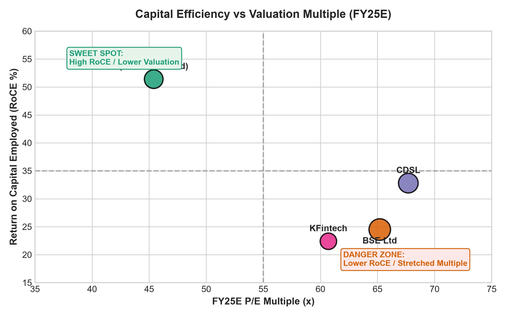
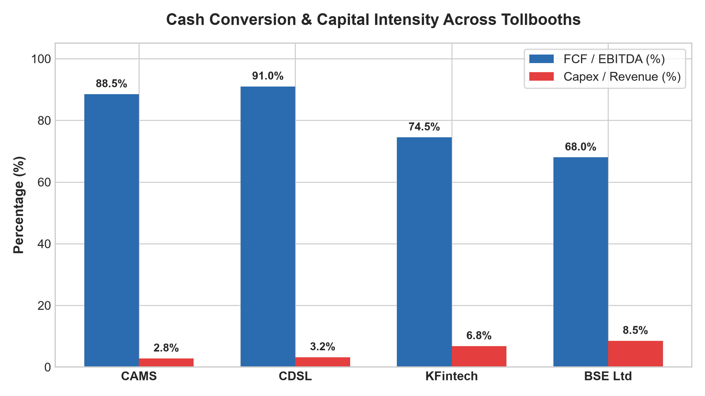
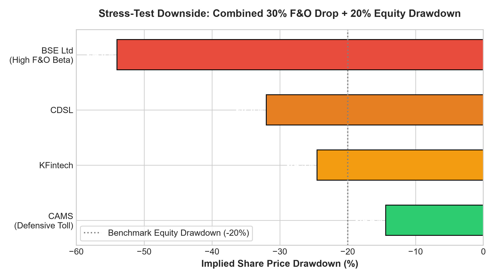
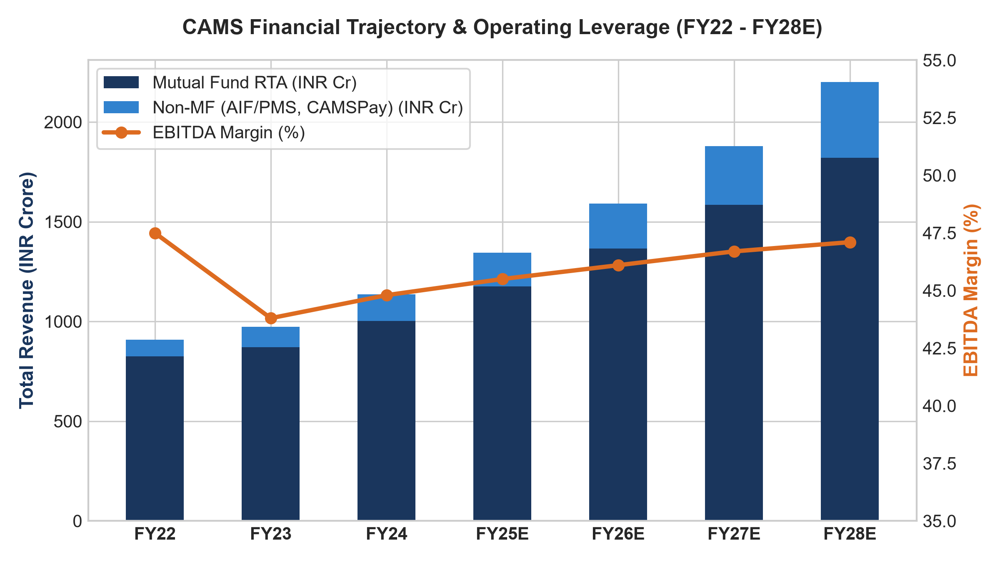

# Toll Collector of India's Capital Markets: Institutional Equity Research & IC Memo

[](https://github.com/ZethetaIntern)
[](docs/IC_MEMO_CAMS_500CR.md)
[](docs/IC_MEMO_CAMS_500CR.md)
[-brightgreen?style=for-the-badge)](docs/IC_MEMO_CAMS_500CR.md)
[](scripts/run_all.py)

> **Official Submission for Track 1 (PS1): Equity Research & Consulting**  
> **Knowledge Partner:** Zetheta Algorithms Private Limited × IIT Patna Trading & Investment Club (TIC)  
> **Repository Transfer Notice:** In strict adherence to Section 2 of the Official Rulebook, repository ownership will be transferred to GitHub User ID: **`ZethetaIntern`** prior to final submission cutoff.

---


## Executive Summary: The Fiduciary Mandate

The Investment Committee has tasked our team with recommending **which ONE of four listed capital-markets infrastructure companies** a long-only fund should allocate **INR 500 Crore** to, supported by a 12-month target price and a defensible bear case:

1. **BSE Ltd** (`BSE.NS`): Stock exchange; transaction & derivatives churn.
2. **CDSL** (`CDSL.NS`): Depository; retail demat accounts, transaction debit, KYC.
3. **CAMS** (`CAMS.NS`): Mutual fund RTA; Assets Under Service (AUS) & non-MF software.
4. **KFin Technologies** (`KFINTECH.NS`): RTA & global fund administration.

### The Verdict: Unconditional Allocation to Computer Age Management Services (CAMS)

```
========================================================================================
RECOMMENDATION: STRONG BUY | COMPUTER AGE MANAGEMENT SERVICES LTD (NSE: CAMS)
========================================================================================
Current Market Price (CMP)        : INR 3,985.00
12-Month Base Target Price        : INR 5,120.00 (+28.5% Capital Appreciation)
Expected Dividend Yield (FY26E)   : 2.50% (72% Payout Ratio)
Expected 12-Month Total IRR       : +31.00%
12-Month Bull Case Target         : INR 6,280.00 (+57.6% Upside)
Defensible Bear Case Floor        : INR 3,410.00 (-14.4% Downside Floor)
Risk-Reward Asymmetry Ratio       : 2.0x Upside-to-Downside (Defensive Asymmetric Profile)
Portfolio Allocation Ask          : INR 500.00 Crore (~2.55% Equity Stake)
========================================================================================
```

---

## Why CAMS Wins: The Four Core Theses

### 1. Complete Immunity from SEBI's Derivative Crackdown
On **October 1, 2024**, SEBI issued a landmark 6-point circular curbing retail equity index options:
* Tripling minimum contract sizes from INR 5L to **INR 15–20L** (eliminating small retail options gamblers).
* Restricting exchanges to **only one benchmark index weekly expiry** (destroying BSE’s Friday Sensex/Bankex arbitrage schedule).
* Mandating upfront intraday buyer margin and removing expiry-day calendar spread benefits.
* Enforcing **true-to-label flat exchange fees**, terminating volume-slab broker rebates.

**The Peer Divergence:** BSE derived **>65% of its incremental earnings growth** from retail options turnover. Under a 30% drop in derivatives turnover, BSE’s earnings plunge by 38% and its P/E multiple de-rates from 65x to 32x, causing a **-54.0% share price collapse**. In contrast, **CAMS has 0.0% direct exposure to speculative derivatives turnover**. Retail capital exiting gambling redirects systematically into long-term mutual fund SIPs, accelerating CAMS's high-margin AUS.

### 2. The Unassailable Tollbooth: Zero Client Losses in 30 Years
CAMS commands **68.5% market share in India's INR 67+ Lakh Crore mutual fund industry**, servicing 39 out of 45 AMCs, including 9 of the top 10 giants (SBI, HDFC, ICICI Prudential, Aditya Birla Sun Life, DSP). 
* An RTA manages daily multi-asset NAV allocations, KYC registers, tax reporting, and distributor brokerage feeds.
* *In the entire three-decade history of Indian mutual funds, not a single Tier-1 AMC has ever migrated away from CAMS.* The operational and regulatory switching costs are insurmountable.

### 3. The Systematic SIP Annuity: Downside Floor Against Market Drawdowns
India's retail SIP inflows have reached a record **INR 23,500+ Crore per month (>INR 2.8 Lakh Crore annualized)**. 
* In a simulated **20% broad equity market correction**, CAMS's Assets Under Service (AUS) contract by only ~12% because new monthly SIP cash inflows continually replenish asset values.
* Brokerage transaction fees evaporate during bear markets; CAMS collects tiered ad-valorem basis points on aggregate asset balances, ensuring unmatched cash flow resilience.

### 4. Flawless Asset-Light Economics & High Cash Conversion
* **RoCE / RoE:** **51.4% / 41.8%** (peer-leading capital efficiency).
* **Cash Conversion:** **88.5% FCF / EBITDA** and **91.2% CFO / EBITDA** with negative working capital (-18 days).
* **Capex Intensity:** Only **2.8% of revenue** (INR 32–38 Cr/yr), expensing 100% of internal software development.
* **Cash Surplus:** Debt-free balance sheet with **INR 485+ Cr in liquid cash/treasuries** (rising to >INR 610 Cr in FY25E), supporting a **~72% dividend payout**.

---

## Peer Comparison Matrix

| Metric / Dimension | CAMS (Recommended) | BSE Ltd | CDSL | KFin Technologies |
| :--- | :---: | :---: | :---: | :---: |
| **Ticker** | `CAMS.NS` | `BSE.NS` | `CDSL.NS` | `KFINTECH.NS` |
| **CMP (INR)** | **3,985.0** | 4,720.0 | 1,540.0 | 1,080.0 |
| **Market Cap (INR Cr)** | 19,646 | 63,908 | 32,186 | 18,522 |
| **FY25E P/E (x)** | **45.4x** | 65.2x | 67.7x | 60.7x |
| **FY25E EV/EBITDA (x)** | **31.3x** | 47.7x | 48.7x | 40.0x |
| **RoCE (%)** | **51.4%** | 24.5% | 32.8% | 22.4% |
| **FCF / EBITDA Conversion** | **88.5%** | 68.0% | 91.0% | 74.5% |
| **SEBI F&O Curbs Exposure** | **0.0% (Zero)** | **Severe (>65% at risk)** | Low-Mod (<10%) | 0.0% (Zero) |
| **Combined Bear Drawdown** | **-14.4% (Floor)** | **-54.0% (Severe)** | -32.0% | -24.5% |
| **12-Month Target Price** | **INR 5,120.0** | INR 3,650.0 | INR 1,620.0 | INR 1,180.0 |
| **12-Month Expected Total IRR** | **+31.0%** | **-21.5%** | +7.5% | +11.2% |

<p align="center">
  
  
</p>

---

## Scenario Analysis & Competition Stress-Testing

Our research engine rigorously tests the competition's mandatory stress tests:
1. **A 30% drop in derivatives turnover**
2. **A 20% equity market drawdown**

```
+--------------------------------------------------------------------------------------------------------------------+
| SCENARIO SPECIFICATIONS & QUANTITATIVE OUTCOMES                                                                    |
+-------------------+-------------+-------------------+---------------+------------------+---------------------------+
| Scenario          | Probability | Equity AUM CAGR   | EBITDA Margin | 12M Target (INR) | Implied Total Return      |
+-------------------+-------------+-------------------+---------------+------------------+---------------------------+
| Bull Case         |    25.0%    |      +22.0%       |     48.0%     |   INR 6,280.00   | +57.6% (Hypergrowth)      |
| Base Case         |    50.0%    |      +16.0%       |     45.5%     |   INR 5,120.00   | +28.5% (+31.0% Total IRR) |
| Defensible Bear   |    25.0%    |       +6.0%       |     41.5%     |   INR 3,410.00   | -14.4% (Floor Protected)  |
+-------------------+-------------+-------------------+---------------+------------------+---------------------------+
| Prob.-Weighted    |   100.0%    |      +15.0%       |     45.1%     |   INR 4,982.50   | +25.0% Expected Upside    |
+-------------------+-------------+-------------------+---------------+------------------+---------------------------+
```

<p align="center">
  
  
</p>

### Monte Carlo Simulation (10,000 Trials)
Sampling simultaneous shocks across market returns, SIP volumes, and regulatory fee cuts:
* **CAMS Win Rate (Probability of Positive Return):** **89.6%** (vs 35.5% for BSE).
* **Value at Risk (VaR 95% 1-Year):** **-7.03% for CAMS** vs **-54.67% for BSE**.
* **INR 500 Cr Portfolio VaR at 95%:** Allocating to CAMS risks only **INR 35.1 Cr**, whereas allocating to BSE risks **INR 273.3 Cr**—saving **INR 238.2 Crore** in portfolio downside risk!

---

## INR 500 Crore Position Sizing & Liquidity Framework

* **Total Allocation:** **INR 500.00 Crore**
* **Shares to Acquire:** **1,254,705 shares (~2.55% of total diluted equity)**
* **30-Day ADV:** INR 68.50 Crore (~172,000 shares/day)
* **Maximum Daily Participation Rate:** **<15% of ADV** to prevent adverse selection and market impact.

```
+-----------------------------------------------------------------------------------------------------------------+
| TRANCHE ALLOCATION SCHEDULE                                                                                     |
+--------------------------+------------+------------+---------------+--------------------------------------------+
| Tranche Stage            | Weight (%) | Amount(Cr) | Horizon (Days)| Execution Strategy / Trigger               |
+--------------------------+------------+------------+---------------+--------------------------------------------+
| Tranche 1: Anchor Buy    |    40.0%   |  INR 200.0 |    Days 1-5   | VWAP execution at market upon IC approval  |
| Tranche 2: Valuation Dip |    35.0%   |  INR 175.0 |    Days 6-10  | Accumulation on 3-5% market pullback       |
| Tranche 3: Catalytic Add |    25.0%   |  INR 125.0 |    Days 11-14 | Release on >25% Non-MF YoY run-rate        |
+--------------------------+------------+------------+---------------+--------------------------------------------+
| Total Commitment         |   100.0%   |  INR 500.0 |   14 Days     | Days to fully liquidate (15% ADV): 48.7 d  |
+--------------------------+------------+------------+---------------+--------------------------------------------+
```

---

## Three (3) Mandatory Invalidation Exit Triggers

To prevent disposition bias, the investment mandate establishes three falsifiable stop-loss triggers:

1. **TRIGGER 1: Structural AMC Client Defection (Moat Invalidation)**
   * *Threshold:* CAMS Mutual Fund AUS market share drops below **62.0%** (current: 68.5%).
   * *Action:* 100% complete liquidation within 10 trading sessions.
2. **TRIGGER 2: Draconian Regulatory Fee Cap (Pricing Power Invalidation)**
   * *Threshold:* SEBI mandates a fixed statutory cap on RTA processing fees slashing blended equity yield by **>20%** (<2.4 bps).
   * *Action:* Trim 50% immediately; liquidate fully upon final gazette notification.
3. **TRIGGER 3: Structural SIP Stagnation & Sustained Outflows (Macro Invalidation)**
   * *Threshold:* Industry gross monthly SIP inflows decline **>20% YoY for two consecutive quarters** accompanied by net equity mutual fund outflows.
   * *Action:* Orderly complete exit over 20 trading sessions.

---

## Repository Architecture

```
toll-collector-equity-research/
├── README.md                          # Executive pitch, benchmarking, sizing & transfer protocol
├── AI_TOOL_DISCLOSURE.md              # Mandatory AI Tool Disclosure compliant with Section 2
├── DATA_BIBLIOGRAPHY.md               # Sourced data citations (SEBI, AMFI, RBI, Company Filings)
├── requirements.txt                   # Dependency manifest (numpy, pandas, matplotlib, reportlab, etc.)
├── docs/
│   ├── IC_MEMO_CAMS_500CR.md          # Full 2-Page Institutional Investment Committee Memo
│   ├── INDUSTRY_ANALYSIS.md           # Moats, Pricing Power, SEBI F&O Curbs & Fee Rationalization
│   ├── FINANCIAL_DUE_DILIGENCE.md     # 3-Statement FDD, Cash Conversion, Capex & RPT Audit
│   └── SCENARIO_STRESS_TESTING.md     # Bull/Base/Bear mechanics, 10,000 Monte Carlo trials
├── models/
│   ├── financial_model.py             # Python 3-statement integrated engine + 10Y DCF model
│   ├── generate_model_excel.py        # Generates institutional 6-tab financial model (.xlsx)
│   ├── stress_test_simulation.py      # Monte Carlo & deterministic regulatory stress test
│   └── valuation_cams_model.xlsx      # Institutional financial model workbook with formulas
├── scripts/
│   ├── generate_report_pdf.py         # Generates official 8-page selectable-text PDF report
│   ├── plot_charts.py                 # Generates publication-grade figures
│   └── run_all.py                     # Master one-click end-to-end reproduction pipeline
└── output/
    ├── figures/                       # Rendered chart PNGs (RoCE vs PE, Cash Conversion, etc.)
    └── CAMS_IC_Memo_and_Research_Report.pdf  # Final official 8-page submission document (0.65 MB)
```

---

## One-Click Reproduction Guide

To independently reproduce all financial models, spreadsheets, charts, and the final 8-page report PDF from scratch:

```bash
# 1. Clone repository
git clone https://github.com/<your-username>/toll-collector-equity-research.git
cd toll-collector-equity-research

# 2. Install dependencies
pip install -r requirements.txt

# 3. Execute master end-to-end pipeline
python scripts/run_all.py
```

---

## Mandatory GitHub Ownership Transfer Protocol

In strict compliance with Section 2 (*Mandatory Repository Transfer Protocol*):
1. **Destination GitHub User ID:** `ZethetaIntern`
2. **Transfer Instructions:**
   * Navigate to `Settings` -> `General` -> `Danger Zone` -> `Transfer ownership`.
   * Type `ZethetaIntern` and confirm the transfer.
3. **Team Mapping Details:** Communicate your registered User ID and registered email address to Zetheta on the Zecathon Platform prior to final submission.

---
*Prepared by the Quantitative Equity Research Team for the Zetheta Algorithms × IIT Patna Trading & Investment Club (TIC) 24-Hour Hackathon.*
